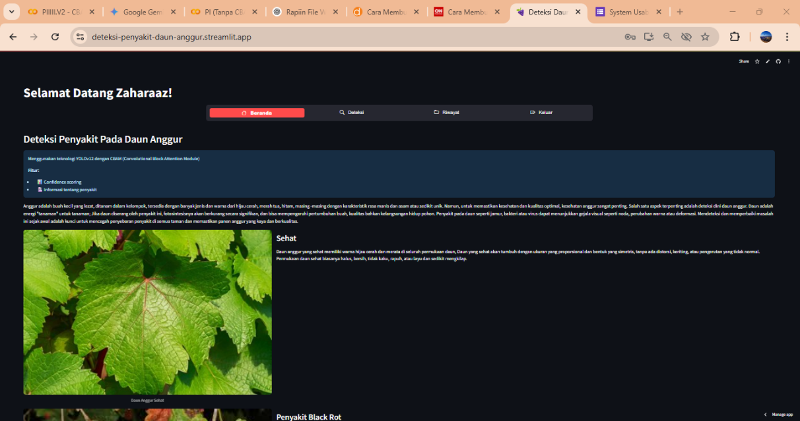
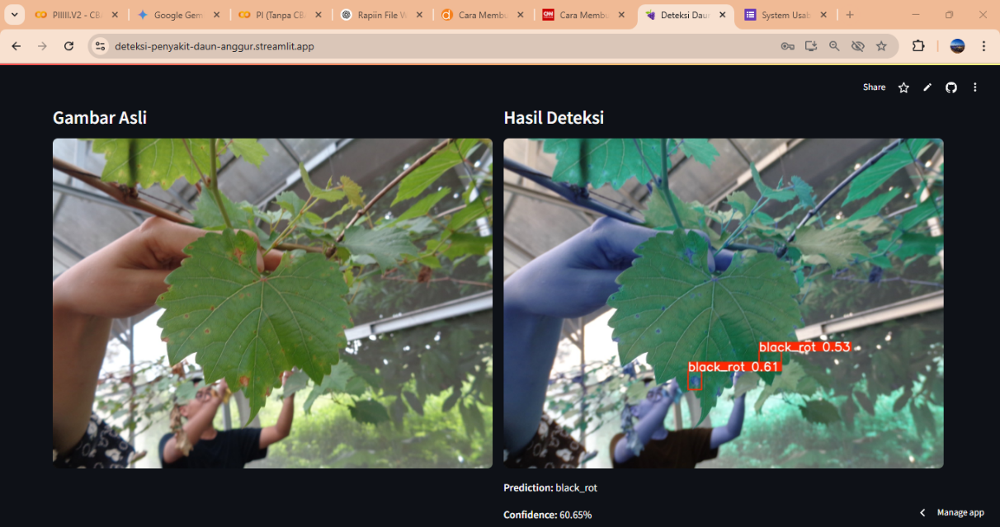

# Grape Leaf Disease Detection: Web App

Streamlit web app for interactive grape leaf disease detection,
powered by a YOLOv12 model trained on a custom + public dataset.

Model training, dataset, and experiments (YOLOv12 vs YOLOv12 + CBAM):
[Grape-Leaf-Disease-Detection](https://github.com/Zaharaaz/Grape-Leaf-Disease-Detection)

## Features
- **Home page:** explains the grape leaf diseases the model detects
  (downy mildew, black rot) 
- **Disease detection:** upload a grape leaf image and get the detected
  disease class, bounding box, and confidence score
- **Detection history:** past detection results are saved and can be
  reviewed later as a history table

## Model
- Architecture: YOLOv12 (Ultralytics), PyTorch
- Detected classes: downy mildew, black rot or healthy
- Performance: 81.9% mAP@0.5 (baseline YOLOv12)
  

## Tech
Python, PyTorch, Ultralytics YOLOv12, Streamlit

## How to run
```bash
git clone https://github.com/Zaharaaz/Deteksi-penyakit-daun-anggur
cd Deteksi-penyakit-daun-anggur
pip install -r requirements.txt
streamlit run app.py
```

## Demo



[Live demo: ](https://deteksi-penyakit-daun-anggur.streamlit.app/)

## Notes
This app is for educational and portfolio purposes and is not a
substitute for expert plant pathology diagnosis.
